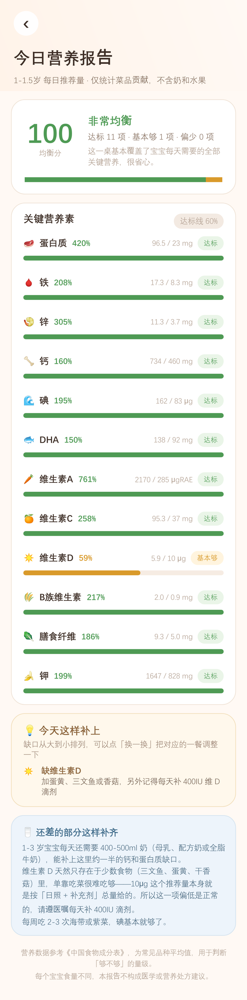
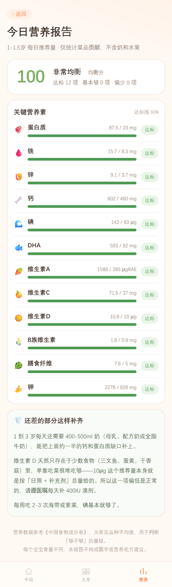
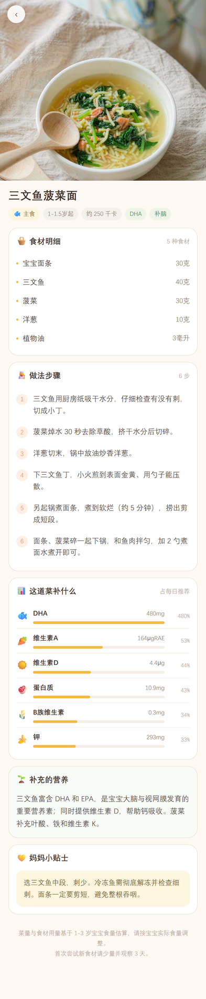

# 宝宝吃什么 🍼

给 1-3 岁宝宝做辅食的 App。每天随机生成一份菜单，**但随机不是瞎随机——按当天的营养缺口去挑菜**，让每一餐都在补上一条短板。

**两套实现，共用一套算法和数据**：Android 原生版（APK 安装）+ 网页版（PWA，iPhone 用 Safari 添加到主屏幕）。

  

## 这个 App 想解决什么

给宝宝做饭最麻烦的不是「不会做」，是「不知道今天该做什么，做完又怕不均衡」。

常见做法是随机抽几道菜凑一桌，结果很容易滑向「天天粥 + 鸡蛋 + 南瓜」——看着花样不少，铁、锌、碘、DHA 长期都是零。

所以这里的核心不是随机，是**先算缺口再点菜**：每次选菜前算出 12 项营养素各自差多少，优先选最能补短板的那道。

## 营养模型

判断依据是《中国居民膳食营养素参考摄入量（2023）》，取 12 项对 1-3 岁发育最关键的营养素：

| 类别 | 营养素 |
|---|---|
| 造血与免疫 | 蛋白质、铁、锌 |
| 骨骼 | 钙、维生素 D |
| 神经与视力 | 碘、DHA、维生素 A |
| 代谢与肠道 | 维生素 C、B 族维生素、膳食纤维、钾 |

**达标线定为「菜品贡献 ≥ 每日推荐量的 60%」**，不是 100%。原因很实际：剩下 40% 由每天 400-500ml 奶补上，这是 1-3 岁真实的饮食结构。按 100% 算会让所有菜单永远「不合格」。

### 关于维生素 D 的一个诚实说明

维 D 天然只存在于极少数食物里——三文鱼（约 11μg/100g）、蛋黄（5.4）、鸡蛋（2）、干香菇（1.6），而每天需要 10μg。**这个推荐量本身是按「日照 + 补充剂」总量给出的，光靠吃菜到不了。**

所以 App 没有假装它达标，而是在营养报告页明确提示：这一项偏低是正常的，请遵医嘱每天补 400IU 滴剂。同时给维 D 单独开了一条加权通道，让含维 D 的鱼类主菜有更大概率被选中。

## 菜谱库

**168 道菜**，每道都有 AI 生成的菜品图、食材明细、分步骤做法、营养说明和小贴士。

按 5 个餐位（早餐 / 午餐 / 下午加餐 / 晚餐 / 睡前加餐）和 5 个类别（主食 / 荤菜 / 蔬菜 / 汤 / 点心）编排，覆盖 3 个月龄段：1-1.5 岁、1.5-2 岁、2-3 岁。

菜谱库是刻意按营养缺口扩出来的——第一版 68 道里 1 岁段**碘 0 道、锌 1 道、维 D 1 道**，算法再好也选不出来，所以先补数据。

## 实测效果

30 天菜单、带历史降权，三个年龄段各跑一遍：

| 月龄 | 均衡分 | 其余 11 项最低 | 维生素 D | 用到的菜品种类 |
|---|---|---|---|---|
| 1-1.5 岁 | **99.9** | 蛋白质 100% | 97% | 101 / 115 |
| 1.5-2 岁 | **99.7** | DHA 93% | 87% | 123 / 168 |
| 2-3 岁 | 99.6 | DHA 97% | 87% | 121 / 159 |

- 月龄 1 菜品池从 61 道扩到 **115 道**（主食 11→25、荤 21→30、素 12→25、汤 7→17、点心 10→18）
- 月龄 1 用到的菜品种类从 56 提升到 **101**，重复率从 97% 降到 89.6%
- 月龄越界 0 次
- 168 道菜营养数据全部可换算，无空值

## 安装

### 安卓：下载 APK

**推荐从 Release 页下载**：[Releases → v1.2.0](https://github.com/Se7eni/baby-meal/releases/latest)，点 **Assets** 下的 `babymeal-v1.2.0.apk`。

直链（手机上打开即可下载）：

```
https://github.com/Se7eni/baby-meal/releases/download/v1.2.0/babymeal-v1.2.0.apk
```

- 文件大小 5.70MB（5,975,027 字节）
- SHA-256：`592e49aea865ba216840a8cd3a5362857dd1643f4138cf20f0d2be8ea00aa46a`
- 最低支持 Android 7.0（API 24），目标 API 34
- 首次启动无需联网，所有数据打包在 APK 内

> ⚠️ **不要用「另存为」保存仓库里的 .apk 文件**。GitHub 的 `blob` 页面保存下来是 HTML 网页而不是安装包；仓库里的原始文件还带中文名，部分手机的下载管理器会截断文件名、丢掉 `.apk` 后缀，导致安装器识别失败。走 Release 附件就没有这两个坑。

安装时如果被拦截，按系统版本授权「安装未知来源应用」；国产 ROM 多在「设置 → 应用管理 → 特殊权限 → 安装未知应用」里单独控制，部分机型还需要关闭「纯净模式」。

### iPhone：用网页版（无需越狱、无需 Apple 开发者账号）

iOS 不允许侧载 APK，装未签名应用要么有 Mac 自签、要么每 7 天重签。**网页版绕开这一整套**：Safari 打开链接 → 添加到主屏幕 → 得到一个跟原生 App 几乎一样、还能离线用的图标。

```
https://se7eni.github.io/baby-meal/
```

```
添加步骤：Safari 打开 → 底部「分享」→ 向下滑 → 「添加到主屏幕」→ 添加
```

- **必须是 Safari**。微信内置浏览器、Chrome for iOS 都不能装主屏幕图标（内核是同一个，但入口受限）
- 装好后是全屏独立窗口，没有地址栏，跟 App 一样
- **首次打开需要联网**（把菜品图和字体缓存进手机，约 6MB），之后断网也能用
- 可以像 App 一样从后台划掉、重新打开，菜单当天不变、换天才换

  

> 想自己部署：站点在仓库的 `docs/` 目录（GitHub Pages 只接受 `/` 和 `/docs` 两个路径）。把 `docs/` 整个扔到任意静态托管（Vercel / Netlify / 自己的 Nginx）即可，不需要后端。注意 Service Worker 要求 **HTTPS**（`localhost` 例外）。

## 自己构建

### 安卓

需要 JDK 17 + Android SDK 34：

```bash
cd app
gradle assembleDebug
# 产物：app/app/build/outputs/apk/debug/app-debug.apk
```

改字体后**必须 `gradle clean assembleDebug`**，增量打包会在 APK 里留下约 10MB/块的 zip 填充空洞。

### 跑测试

```bash
cd app
gradle testDebugUnitTest
```

14 个用例：7 个页面渲染（Robolectric `@GraphicsMode(NATIVE)` 真实渲染截图到 `app/app/build/render/`）+ 7 个逻辑校验（数据完整性、营养换算、月度均衡、重复率、同日稳定性等）。

### 网页版

纯静态，没有构建步骤。本地起服务：

```bash
cd docs
python -m http.server 8080
# 浏览器打开 http://localhost:8080
```

四个验证脚本在 `dev/web-verify/`（需要本机有 Chrome）：

```bash
cd dev/web-verify
node verify.js        # 算法移植校验：营养换算完整性、同日幂等、30 天均衡度
node test.js          # 交互冒烟测试：20 项断言，走 CDP 真实点击
node test-offline.js  # PWA 离线验证：SW 激活 → 缓存写入 → 断网仍可渲染
node live-check.js    # 线上验收：直接打 GitHub Pages，查 404 / SW / 断网
```

`shot.js` 用来生成 README 里的截图（iPhone 14 Pro 视口，2x DPR）。传 `SITE_URL` 可以打线上：

```bash
SITE_URL=https://se7eni.github.io/baby-meal/ node shot.js all
```

## 项目结构

```
docs/                 # PWA 站点（GitHub Pages 直接指向这里）
  js/nutrition.js     # Nutrition.java 的 1:1 移植（12 项 × 77 种食材）
  js/menu.js          # MenuEngine.java 的 1:1 移植（可复现 PRNG 替代 java.util.Random）
  js/app.js           # 四页面渲染 + 路由 + localStorage
  sw.js               # Service Worker：导航网络优先、资源缓存优先
  manifest.json       # standalone 显示模式 + 三档图标
  img/dishes/         # 168 张菜品图（AI 生成）
dev/web-verify/       # 网页版的四个验证脚本 + 截图工具
app/
  app/src/main/java/com/babymeal/app/
    Nutrition.java      # 营养引擎：77 种食材营养表 + 12 项推荐量 + 达标判定
    MenuEngine.java     # 选菜算法：历史降权 × 随机抖动 × 缺口匹配 × 稀缺营养加成
    NutritionScreen.java# 营养报告页：均衡分 / 12 项明细 / 缺口补救建议
    TodayScreen.java    # 今日菜单 + 营养小格
    DetailScreen.java   # 菜品详情 + 这道菜贡献了多少营养
    ...
  app/src/main/assets/
    dishes.json         # 168 道菜
    dishes/*.webp       # 168 张菜品图（AI 生成）
    fonts/              # 思源黑体子集（31MB → 780KB）
  data/                 # 数据生成与验证脚本（Python）
    build_dishes.py     # 菜谱构建
    add_dishes.py       # 按营养缺口补菜
    add_vitd_dishes.py  # 补高维 D 主菜
    normalize_ingredients.py
    build_prompts*.py   # 图片提示词
    map_images*.py      # 图片映射、裁水印、转 WebP
    subset_font.py      # 字体子集化
    make_web_icons.py   # PWA 图标（4x 超采样，apple-touch-icon 无 alpha）
    sim_balance.py      # 离线复刻选菜算法，对比不同加权方案
    sim_vd_bonus.py     # 专测稀缺营养素加成系数
```

### 两端怎么保证一致

算法不是「重写一遍」，是逐函数移植，然后用同一份数据跑对照：

| 校验项 | 安卓（JVM 单测） | 网页（Node） |
|---|---|---|
| 168 道菜营养换算 | 全部可换算 | 全部可换算，0 例外 |
| 同一天重复生成 | 结果恒定 | `s03\|s10,m27,v14\|k12\|s21,v21,p01\|k11` 恒定 |
| 30 天均衡分（1 岁段） | 100 | 99.4 |

差 0.6 分来自浮点累加顺序，菜单内容本身一致。随机数用 `mulberry32` 复刻了 `java.util.Random` 的「同种子同序列」语义，`javaHash` 也按 Java `String.hashCode` 的 32 位溢出规则实现，所以两端拿同一个日期字符串算出的菜品是同一套。

## 关于选菜算法的两个发现

1. **改 `fitScore` 的数学公式没用。** 把「各项缺口加权平均」改成「主导项优先」，离线模拟 3 组种子各 60 天，维 D 反而从 63% 降到 53%。这版代码最终保留了原来的公式。

2. **真正有效的是给稀缺营养单独加权。** 2 岁段能上两餐的高蛋白主菜有 30 道，含维 D 鱼的只有 10 道，普通加权抢不到出场机会。加一条独立加成通道后，达标率从 40-62% 抬到 70-90%，其余 11 项不掉，均衡分还升了。

系数取 4 是模拟试出来的——6 和 8 提升不明显，反而会让菜单反复出现鱼类。

## 免责

营养数据参考《中国食物成分表》常见品种平均值，用于判断「够不够」的量级。每个宝宝食量不同，**本 App 不构成医学或营养处方建议**，具体请遵医嘱。
